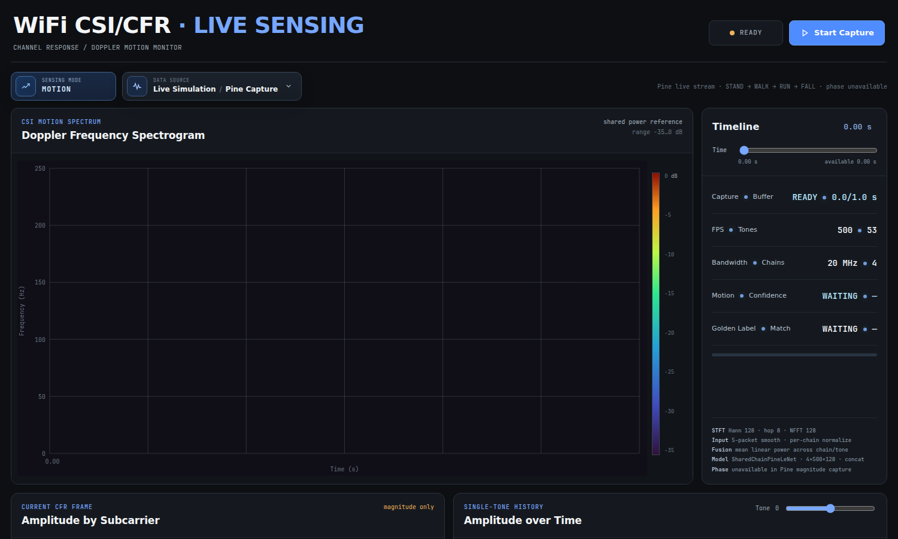

# Wi-Fi CSI/CFR Live Sensing Demo

An interactive dashboard for visualizing Wi-Fi CSI/CFR captures and demonstrating motion inference with a PyTorch model.

The project includes recorded Pine examples, a simulated live CFR stream, STFT visualization, a trained motion-classification checkpoint, and a browser dashboard with real server-side inference.



## Features

- Rolling CSI/CFR STFT visualization
- Current-frame amplitude by subcarrier
- Single-tone amplitude history
- Motion metric and threshold display
- Built-in Run, Walk, Pick, Lie, Fall, Stand, and Sit examples
- Simulated live capture with golden-label comparison
- Real PyTorch inference through the local HTTP service
- Self-contained generated Dashboard with embedded visualization data

## Processing pipeline

The bundled Pine examples use the following pipeline:

1. Select 53 active tones from each chain.
2. Apply five-packet temporal smoothing.
3. Normalize once per chain across time and tones.
4. Apply a 128-frame Hann STFT with an eight-frame hop.
5. Average linear power across tones and chains.
6. Convert power to dB using one reference shared by all examples.

The STFT frequency axis describes how quickly CSI/CFR changes over time. It is not the OFDM subcarrier frequency axis.

## Repository layout

```text
csi_demo/
├── examples/              Bundled Pine recordings and labelled live stream
├── models/                PyTorch checkpoint
├── out/                   Generated Dashboard and plots
├── tools/                 Generation, plotting, serving and inference tools
├── README.md
└── requirements.txt
```

## Setup

Python 3.11 or newer is recommended.

```bash
python3 -m venv .venv
source .venv/bin/activate
python -m pip install -r requirements.txt
```

With `uv`:

```bash
uv venv
uv pip install -r requirements.txt
```

## Generate the Dashboard

```bash
.venv/bin/python tools/dashboard.py
```

The generated page is written to:

```text
out/dashboard.html
```

## Run locally

```bash
bash tools/run_local_dashboard.sh
```

Open:

```text
http://127.0.0.1:8000/dashboard.html
```

The launcher starts:

- Dashboard server on port `8000`
- PyTorch inference service on local-only port `8765`
- Same-origin `/api/infer` proxy from the Dashboard to the inference service

The Dashboard server listens on `0.0.0.0` so another machine on the same network can use:

```text
http://<host-ip>:8000/dashboard.html
```

Only the generated `out/` directory is exposed by the HTTP server. The model, scripts and source recordings are not directly served.

## Live inference

The included checkpoint is `models/pine_shared_lenet_concat.pt`.

```text
Model input: 4 chains × 500 frames × 128 tones
Simulation period: 2 ms
Inference window: 500 frames / 1 second
Inference hop: 50 frames / 100 ms
```

The browser does not contain a precomputed prediction timeline. Once enough simulated frames have been captured, it sends the current window to the local service and displays the returned Softmax label and confidence.

## Additional tools

Generate static STFT plots:

```bash
.venv/bin/python tools/plot_pine_stft.py --scene all
```

Generate a progressive replay GIF:

```bash
.venv/bin/python tools/render_pine_stft_replay.py --scene live
```

Run checkpoint inference directly:

```bash
.venv/bin/python tools/infer_pine_live.py \
  --checkpoint models/pine_shared_lenet_concat.pt \
  --input examples/pine/fall/cfr_41.txt \
  --output models/pine_fall_cfr41_predictions.json \
  --period-ms 2 \
  --hop 8
```

More details are available in [tools/README.md](tools/README.md).

## Notes

- Pine captures contain magnitude data only; phase is not synthesized.
- The live source is a labelled replay used to demonstrate capture and inference behavior.
- Real CFR deployments should derive timing from record timestamps instead of assuming the configured capture period is exact.
